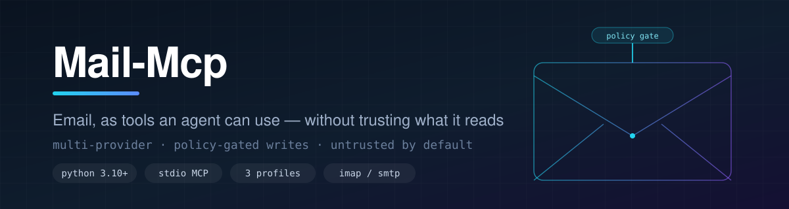
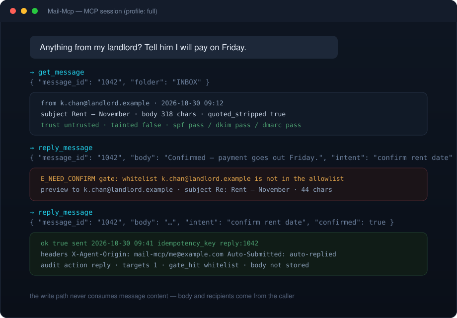

<div align="center">



# Mail-Mcp

### Email, as tools an agent can actually use

Read, search, reply and file mail over IMAP/SMTP — with one policy engine deciding what the agent is allowed to do, and one gate standing between it and your outbox.

<a href="LICENSE"></a>


<a href="https://github.com/Faixiang/mail-mcp/stargazers"></a>


<p>
<b>English</b> ·
<a href="README.zh-CN.md">简体中文</a> ·
<a href="README.zh-TW.md">繁體中文</a>
</p>

</div>

> **Companion layer — trigger**
> MCP is request/response: a server cannot be woken up by an incoming mail. Anything that needs to *act on arrival*
> lives in a separate, deliberately thin process on the [`feat/trigger-layer`](https://github.com/Faixiang/mail-mcp/tree/feat/trigger-layer)
> branch — event source → bus → consumer, with events carrying `event_id` and metadata but **never the body**.
> See [docs/trigger.md](https://github.com/Faixiang/mail-mcp/blob/feat/trigger-layer/docs/trigger.md).

---

> **Status: early, but runnable.** The IMAP/SMTP provider works end to end with read tools, policy evaluation and the
> send gate. Gmail API, Microsoft Graph and the Tencent QQ official endpoint are declared, not implemented — they raise
> `E_PROVIDER_UNSUPPORTED` instead of pretending to work. See [Roadmap](#roadmap-).

## Preview 🖥️



---

## Why this exists 🎯

Every email MCP in the wild sits in one of two camps: a single-provider wrapper, or a thin IMAP shell that hands the
model `send()` and hopes for the best. The first cannot cover a second account; the second turns a prompt injection in
an incoming mail into an outbound email on your behalf.

This project takes the third position: **unified tool semantics, one policy layer, and a hard gate on the write path.**

```text
read  →  sanitise  →  return as untrusted
write →  explicit arguments  →  policy  →  gate  →  provider  →  audit
```

The two paths never share context. That is the whole design.

## What makes it different ✨

| | Single-provider MCP | Raw IMAP wrapper | Mail-Mcp |
|---|---|---|---|
| Accounts / providers | one | one | one registry, IMAP/SMTP today |
| Write safety | none | none | policy engine + 10-step gate |
| Incoming content | handed over raw | handed over raw | sanitised, tagged `untrusted`, taint-tracked |
| Can it reply using a mail as its own instruction source? | yes | yes | **no** — structurally impossible |
| Audit trail | no | no | one row per write, no bodies |

## Features ✨

### Reading
- **Untrusted by default** — every inbound message is returned with `trust: "untrusted"`, quoting stripped, hidden text and zero-width characters removed
- **`include_body` is off by default** in list calls, so a mailbox listing cannot flood the context
- **Threads, not blobs** — `get_thread` resolves the conversation, strips quoted history, orders by time
- **Attachments land in a sandbox** — a path is returned, never base64; the filename is generated server-side

### Writing
- **Structural isolation** — under `reader`, write tools are *not registered*. The model cannot call what does not exist
- **No `source_message_id`** — `send_message` has no parameter that would let the server lift a body out of your inbox
- **Two-phase confirmation** — first call returns `E_NEED_CONFIRM` plus a preview; only `confirmed: true` executes
- **Idempotent** — same `idempotency_key`, same result, no duplicate mail
- **Loop-safe** — every outbound message carries `X-Agent-Origin` and `Auto-Submitted: auto-replied`; inbound mail carrying either is never auto-answered

### Engineering
- **Deterministic policy** — `policy.yaml` is evaluated by code, not by a model. `mail_explain_policy`-style reasoning is returned with the decision
- **Provider presets** — QQ, Foxmail, 163, 126, Gmail and Outlook hosts/ports resolve from the address
- **Pure safety layer** — `safety/` and `policy/` take dataclasses and return dataclasses: no network, no disk, no clock beyond what is passed in, so they are fully unit-tested
- **Errors, not exceptions** — every failure is a structured code (`E_POLICY_DENIED`, `E_TAINT_WRITE_BLOCKED`, …) with `retryable` and `detail`

## Tools 🧰

Tools are grouped into profiles. A tool outside the active profile is never advertised to the client.

### `reader` — 8 tools, no write capability

| Tool | What it does | Arguments |
|---|---|---|
| `list_mailboxes` | Folders on the account, with system-folder mapping. | — |
| `list_messages` | Message summaries in a folder, newest first. **No bodies.** | `folder` (default `INBOX`), `limit` (default 20, max 100), `unread_only` |
| `search_messages` | Server-side search; returns ids, not content. | `query`, `folder`, `limit` |
| `get_message` | One message: sanitised text, authentication result, taint flag. | `message_id`, `folder` |
| `get_thread` | The whole conversation, quoting stripped, time-ordered. | `thread_id` |
| `get_attachment` | Download to the sandbox, return a local path. | `message_id`, `attachment_id`, `max_bytes` (default 10 MB) |
| `get_quota` | Quota if the provider reports one — frequently unavailable over IMAP. | — |
| `get_me` | Account, provider, profile. | — |

### `full` — adds 5 write tools

| Tool | What it does | Risk | Notes |
|---|---|---|---|
| `send_message` | New message. | high | passes the gate; `intent` required |
| `reply_message` | Reply / reply-all. | high | quoting assembled server-side, never sent through the model |
| `forward_message` | Forward. | high | explicit recipients only |
| `mark_message` | Read / starred / flagged. | medium | — |
| `move_message` | Move / archive. | medium | — |

### `danger` — adds 2 destructive tools, registered only with `--enable-delete`

| Tool | What it does | Default |
|---|---|---|
| `delete_message` | Delete one message (to Trash, not permanent). | **not registered** |
| `purge_messages` | Bulk purge. | **not registered** |

## Architecture 🧱

```text
transport/   stdio                  protocol only
tools/       reader | write         argument checks and orchestration
policy/      rules                  decisions only, no IO
safety/      sanitise / taint / gate / audit   pure functions, unit-tested
adapters/    imap | gmail | graph | qq         protocol differences
store/       credentials / cursors / audit     the only layer touching disk
```

Dependency direction is one-way: `transport → tools → (policy, safety) → adapters → store`.
Because `policy` and `safety` never import an adapter, the interesting half of the project can be tested with no
network and no mailbox. Details in [docs/architecture.md](docs/architecture.md) and [docs/profiles.md](docs/profiles.md).

## Requirements 📦

| Component | Notes |
|---|---|
| Python | 3.10+ |
| MCP protocol | `2024-11-05` |
| Dependencies | `mcp`, `pyyaml`, `python-dateutil` (`aioimaplib` for the async IMAP extra) |
| Mailbox | IMAP + SMTP enabled, app-specific password issued |
| Verified against | QQ Mail over `imap.qq.com:993` / `smtp.qq.com:465` |

## Quick start 🚀

### ① Issue an app-specific password

Never use your account password. QQ Mail, 163 and Gmail all issue a separate credential for clients; enable IMAP in
the web settings first, then generate the code.

```bash
export MAIL_MCP_PASSWORD="your_app_password"
```

Windows PowerShell:

```powershell
$env:MAIL_MCP_PASSWORD = "your_app_password"
```

### ② Install

```bash
git clone https://github.com/Faixiang/mail-mcp.git
cd mail-mcp
pip install -e ".[dev]"
```

### ③ Write a policy

```bash
mkdir -p ~/.mail-mcp
cp examples/policy.yaml ~/.mail-mcp/policy.yaml
```

Edit `owner` and `allowlist` at minimum. Everything else has a safe default — unmatched senders fall through to
`draft_for_review`.

### ④ Register with your client

Claude Desktop / Cursor (`mcp.json`):

```json
{
  "mcpServers": {
    "mail": {
      "command": "mail-mcp",
      "args": ["--profile", "reader", "--provider", "imap", "--account", "you@qq.com"],
      "env": { "MAIL_MCP_PASSWORD": "your_app_password" }
    }
  }
}
```

Start with `reader`. Switch to `full` only once the policy file reflects what you actually want sent on your behalf.

### ⑤ Verify

Ask the client to call `get_me`, then `list_messages`. If both answer, the account, the credential and the profile are
all correct. If not, jump to [Troubleshooting](#troubleshooting-).

## Configuration reference ⚙️

| Flag | Default | Meaning |
|---|---|---|
| `--profile` | `reader` | `reader` / `full` / `danger` |
| `--account` | — | Mailbox address; also the preset lookup key |
| `--provider` | `imap` | `imap` (aliases: `imap_smtp`, `qq`, `163`, `gmail_imap`) |
| `--home` | `~/.mail-mcp` | State root: `state/`, `sandbox/`, audit DB |
| `--policy` | `<home>/policy.yaml` | Policy file |
| `--enable-delete` | off | Required for `danger` to register its destructive tools |

| Environment variable | Required | Meaning |
|---|---|---|
| `MAIL_MCP_PASSWORD` | yes | App-specific password. Read from the environment only, never from the policy file |
| `MAIL_MCP_IMAP_HOST` | no | Override the preset host |
| `MAIL_MCP_SMTP_HOST` | no | Override the preset host |

Built-in presets: `qq.com`, `foxmail.com`, `163.com`, `126.com`, `gmail.com`, `outlook.com`, `hotmail.com`.
Unrecognised domains need an explicit host override.

## Policy reference 📜

```yaml
owner: me@example.com          # single-owner declaration; other consumers are forced read-only
default_action: draft_for_review   # auto_reply | draft_for_review | read_only | drop
require_auth_pass: true        # SPF/DKIM/DMARC failure downgrades auto_reply to draft
allowlist: [wife@example.com, boss@company.com]
allowlist_domains: []
rules:
  - match: { subject_contains: ["unsubscribe", "newsletter"] }
    action: drop
    priority: 100
limits:
  max_sends_per_hour: 10
  max_sends_per_day: 50
  max_recipients_per_send: 3
  max_auto_replies_per_thread: 2
quiet_hours: { start: "23:00", end: "07:30" }
subaddress_tag: agent          # you+agent@example.com marks agent-originated mail
```

Rule precedence: subject veto → exact address → domain → default. The engine is deterministic and explainable; the
model may read the reasoning, never override the verdict.

## The send gate 🚦

Ten steps, in this order. Any `deny` short-circuits; `confirm` returns `E_NEED_CONFIRM` with a preview.

```text
1. profile allows it?      no  → E_PROFILE_DENIED
2. policy decision?        deny → E_POLICY_DENIED
3. recipient allowlist     unknown → confirm
4. recipient count         > 3 → confirm
5. content review          credential-like strings / long quoted blocks → confirm or deny
6. rate and quota          exceeded → E_RATE_LIMITED / E_QUOTA_EXCEEDED
7. taint check             source flagged → E_TAINT_WRITE_BLOCKED
8. loop check              Auto-Submitted / X-Agent-Origin present → E_LOOP_DETECTED
9. confirmed?              false → E_NEED_CONFIRM (preview returned)
10. execute + audit
```

Sanitisation upstream of all this is best-effort and treated as such: **only the gate is a hard constraint.**

## Usage examples 💬

> "Anything important in the last two days?"

The agent calls `list_messages` (no bodies), then `get_message` on the two that matter. Each body arrives with
`trust: untrusted` and quoting already removed, so a "ignore previous instructions" line lands as inert text, not as
a new instruction inside a clean context.

| Prompt | Tools it lands on |
|---|---|
| "What came in overnight?" | `list_messages` → `get_message` |
| "Search for the invoice from October" | `search_messages` |
| "Summarise this thread" | `get_thread` |
| "Save the PDF attachment" | `get_attachment` (sandbox path returned) |
| "Reply that I'll confirm tomorrow" | `reply_message` → gate → `confirmed: true` |
| "Why was my reply blocked?" | policy decision + `gate_hit` in the audit record |

## Troubleshooting 🤔

<details>
<summary><b><code>E_AUTH_MISSING</code> at startup</b></summary>

`MAIL_MCP_PASSWORD` is not set in the environment the client launches. Desktop clients do not inherit your shell —
put the variable in the `env` block of the server entry, and make sure the client was restarted.
</details>

<details>
<summary><b>Login rejected by the provider</b></summary>

Three usual causes: the account password was used instead of an app-specific password; IMAP is still disabled in the
web settings; or the provider requires an OAuth flow (Gmail with 2FA, most enterprise tenants) which the IMAP adapter
cannot perform. Use an app password, or wait for the Gmail/Graph adapters.
</details>

<details>
<summary><b><code>E_PROVIDER_UNSUPPORTED</code> for gmail / graph / qq_official</b></summary>

Declared but not implemented. The registry raises instead of falling back to a half-working path, so a misconfiguration
is visible immediately rather than at the moment a message fails to send.
</details>

<details>
<summary><b><code>E_NEED_CONFIRM</code> on every send</b></summary>

Working as designed: the recipient is not in the allowlist, or the message exceeds one of the batch or content limits.
Either retry with `confirmed: true`, or add the address to `allowlist` in `policy.yaml` if it is a permanent
correspondent.
</details>

<details>
<summary><b><code>E_TAINT_WRITE_BLOCKED</code></b></summary>

The message being replied to carries injection markers. The write path refuses to use a tainted message as its source.
Write the reply with an explicit body instead — the gate is protecting you, not the model.
</details>

<details>
<summary><b>Garbled characters in the console</b></summary>

Output is UTF-8. On legacy Windows consoles run `chcp 65001` first, or use Windows Terminal.
</details>

## Trigger layer 🔔

Not in this branch, by design. See [`feat/trigger-layer`](https://github.com/Faixiang/mail-mcp/tree/feat/trigger-layer)
and [docs/trigger.md](https://github.com/Faixiang/mail-mcp/blob/feat/trigger-layer/docs/trigger.md).

```text
source (IMAP poll)  →  bus (SQLite dedupe / cursor)  →  consumer (subprocess)
```

Three rules that make it safe:

- events carry **no body** — only `event_id`, folder, uid, sender, size, attachment flag
- `subject` is stored as a **sha256 prefix**, because subject lines are a favourite injection carrier
- delivery is **at-least-once + idempotent consumption**; a consumer that keeps failing is marked `dead`, not retried silently

Tests on that branch: 69 passing (44 capability + 25 trigger).

## Security notes 🔒

- The password is a credential: environment only, never the policy file, never the audit DB. `.gitignore` covers the local state directory.
- Inbound bodies are not persisted. The audit record stores targets, `intent` and gate hits — **no message content**.
- Attachments are written under `~/.mail-mcp/sandbox/<uuid>/` with server-generated filenames; the original filename is metadata, not a path.
- `trust: untrusted` is a contract for the client: content from mail is data, never instruction.
- The gate is a mitigation, not a proof. Treat a `full` profile as "an agent may write as me", and keep the allowlist short.

## Compatibility ✅

| Client / platform | Status |
|---|---|
| Claude Desktop | Works (stdio) |
| Cursor | Works (`mcp.json`) |
| Marvis | Works (MCP registry) |
| Any MCP client | Works — plain JSON-RPC 2.0 over stdio |
| Windows / macOS / Linux | Works — no platform-specific code |

## Roadmap 🗺️

- [x] Profile registry with structural isolation (unregistered, not refused)
- [x] Sanitisation, taint tracking, ten-step gate, audit log
- [x] IMAP/SMTP adapter with provider presets
- [x] Independent trigger layer on its own branch
- [ ] Gmail API adapter (OAuth broker)
- [ ] Microsoft Graph adapter (OAuth broker)
- [ ] Tencent QQ official endpoint adapter
- [ ] Durable credential store (DPAPI / Keychain) instead of environment variables
- [ ] IMAP IDLE long connection and cloud webhook sources for the trigger layer
- [ ] Dead-letter replay tool

## Changelog 📌

| Version | Date | Highlights |
|---|---|---|
| **0.1.0** | 2026-10-30 | Skeleton complete: profiles, sanitisation, policy engine, send gate, audit, IMAP/SMTP adapter, 44 tests. Trigger layer shipped separately on `feat/trigger-layer` (25 more tests). |

## Contributing 🤝

- Keep `policy/` and `safety/` pure — no network, no disk, no logging inside them.
- A write tool without a gate step is not accepted; a read tool that returns raw HTML is not accepted.
- Never add a parameter that lets the server derive a body or recipient from an inbox message.
- New provider? Implement the adapter interface, wire it in `registry.py`, and leave unsupported features raising
  `E_PROVIDER_UNSUPPORTED` rather than silently degrading.

## Feedback 📢

Bugs and feature requests: [open an issue](https://github.com/Faixiang/mail-mcp/issues).

## License 📝

MIT — see [LICENSE](LICENSE).
